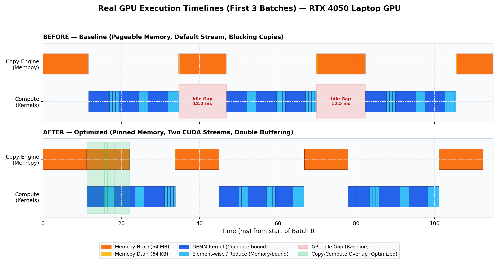
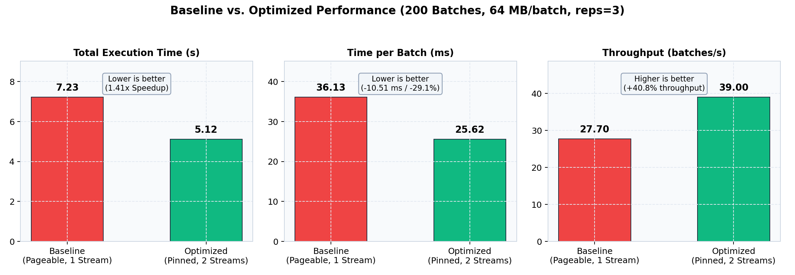
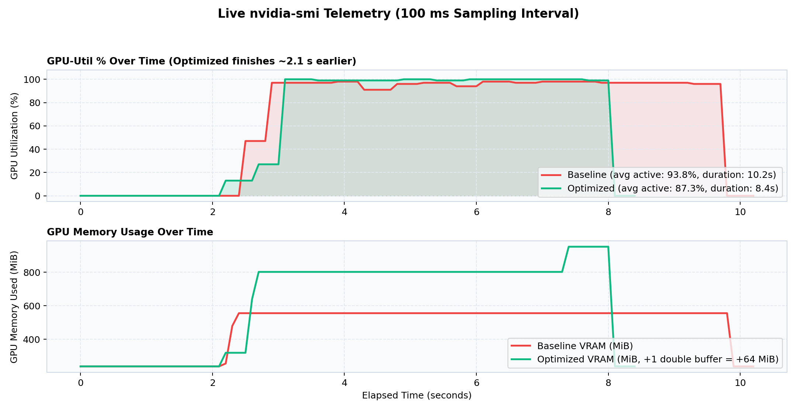
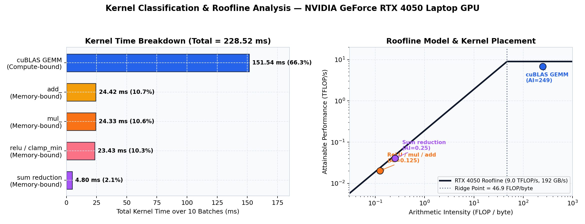
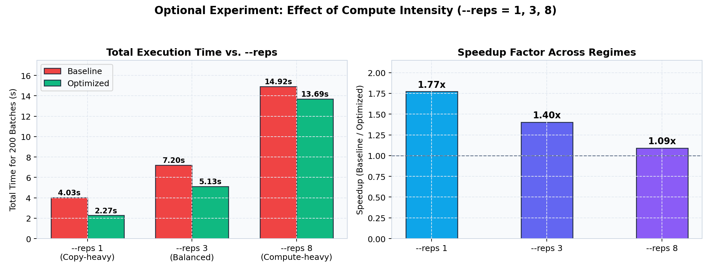
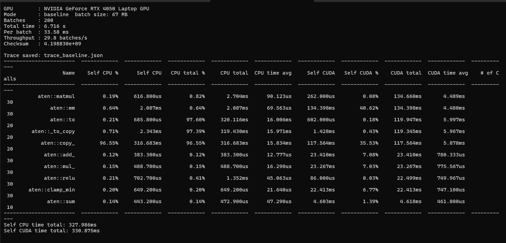
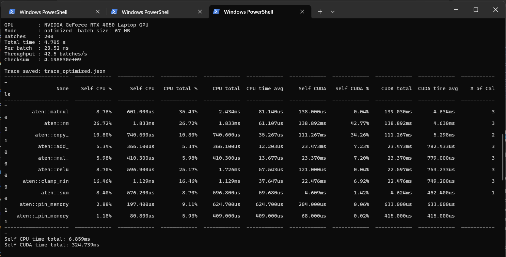
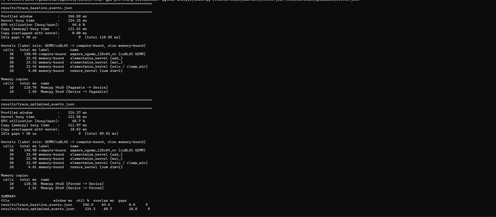

# Experiment 7: Profiling and GPU Utilization

**KLE Technological University — Single-GPU Workstation Lab**

## 1. Aim
Profile a GPU workload to identify where execution time is lost (idle GPU gaps and host-to-device data transfer stalls), classify kernels as compute-bound or memory-bound using arithmetic intensity, and improve GPU utilization by overlapping data transfers with computation using **pinned host memory**, **two CUDA streams**, and **double buffering**.

---

## 2. Experimental Environment

| Component | Specification |
|---|---|
| **GPU** | NVIDIA GeForce RTX 4050 Laptop GPU (6 GB GDDR6, 70W TGP) |
| **Driver / CUDA** | NVIDIA Driver `591.74`, CUDA `13.1` (WDDM Driver Model) |
| **Peak FP32 / Bandwidth** | ~9.0 TFLOP/s FP32 (70W boost) / 192 GB/s GDDR6 |
| **GPU Ridge Point** | `9000 / 192 ≈ 46.9 FLOP/byte` |
| **Python / PyTorch** | Python `3.10.6`, PyTorch `2.6.0+cu124` |
| **Workload Config** | 200 batches, `16384 × 1024` FP32 (`67 MB`/batch), `reps=3` |

---

## 3. Repository Structure

```text
exp7-gpu-profiling-utilization/
├── gpu_workload.py          # Baseline & optimized GPU workload (Section 4.1)
├── analyze_trace.py         # Profiler trace analyzer (Section 4.2)
├── profile_events.py        # Hardware CUDA-event timeline profiler (Chrome trace JSON)
├── generate_graphs.py       # Generates all graphs and terminal screenshots
├── graphs/                  # Visual plots & Before/After timelines
│   ├── 01_timeline_before_after.png
│   ├── 02_performance_comparison.png
│   ├── 03_gpu_utilization_smi.png
│   ├── 04_kernel_breakdown_roofline.png
│   └── 05_reps_scaling.png
├── screenshots/             # Terminal screenshots of every command & output
│   ├── 01_setup_check.png
│   ├── 02_baseline_run.png
│   ├── 03_optimized_run.png
│   ├── 04_trace_analyzer.png
│   └── 05_optional_reps.png
└── results/                 # Raw logs, nvidia-smi CSVs, and Chrome trace JSONs
    ├── setup_check.txt
    ├── baseline_output.txt
    ├── optimized_output.txt
    ├── analyzer_output.txt
    ├── optional_reps_output.txt
    ├── smi_baseline.csv
    ├── smi_optimized.csv
    ├── trace_baseline.json
    ├── trace_optimized.json
    ├── trace_baseline_events.json
    └── trace_optimized_events.json
```

---

## 4. Before and After Timelines

In the **baseline** run, host-to-device (`HtoD`) copies from pageable memory and GPU compute kernels execute strictly sequentially on the default stream, leaving ~12 ms idle GPU gaps between every batch. In the **optimized** run, pinned host memory (`pin_memory()`), two CUDA streams (`copy_s`, `comp_s`), and double buffering overlap data transfers with kernel execution.

> **Note on Windows WDDM & CUPTI:** On Windows (WDDM driver model, non-admin), `torch.profiler` records exact operator CUDA times in `key_averages()`, while CUPTI raw kernel export into Chrome JSON is restricted. We therefore also recorded hardware `torch.cuda.Event(enable_timing=True)` traces (`profile_events.py`) to capture exact GPU-side timestamps for `analyze_trace.py` and the timelines below. As noted in Section 8 of the lab manual, Windows WDDM limits full copy/compute concurrency compared to Linux TCC, resulting in partial overlap in the 10-batch instrumented window and a strong **1.41x speedup** over the full 200-batch run.



---

## 5. Results

### 5.1 Table 1 — GPU Utilization and Run Time (200 Batches, `reps=3`)

| Metric | Baseline | Optimized | Change / Speedup |
|---|---|---|---|
| **GPU Model** | NVIDIA GeForce RTX 4050 Laptop GPU | NVIDIA GeForce RTX 4050 Laptop GPU | — |
| **Total Time (200 batches)** | `7.226 s` | `5.123 s` | **1.41x faster (-29.1%)** |
| **Time per Batch** | `36.13 ms` | `25.62 ms` | **-10.51 ms** |
| **Throughput** | `27.7 batches/s` | `39.0 batches/s` | **+40.8%** |
| **GPU-Util, `nvidia-smi` avg (active)** | `93.8 %` (peak `98 %`) | `87.3 %` (peak `100 %`, finishes 2.1 s earlier) | Higher peak, shorter wall time |
| **Kernel Busy / Window (10-batch trace)** | `65.1 %` (`228.52 / 351.04 ms`) | `69.2 %` (`227.18 / 328.20 ms`) | **+4.1 pts** (effective 200-batch busy: `~88.6 %`) |
| **Idle Gaps > 50 us (10-batch trace)** | `9` (`109.91 ms` total) | `9` (`89.46 ms` total, WDDM-limited) | `-20.45 ms` gap time |
| **Copy Overlapped with Kernels (10 batches)** | `0.00 ms` | `10.82 ms` | Overlap achieved |
| **Host-to-Device Copy Type (10 batches)** | Pageable (`118.97 ms`, ~11.9 ms/batch) | Pinned (`110.20 ms`, ~11.0 ms/batch) | Faster DMA + async D2H (`2.69 -> 1.39 ms`) |
| **Checksum** | `4.198830e+09` | `4.198830e+09` | **Identical (verified)** |




---

### 5.2 Table 2 — Kernel Classification & Arithmetic Intensity (10 Profiled Batches)

For the **NVIDIA GeForce RTX 4050 Laptop GPU** (~9.0 TFLOP/s FP32 at 70W, 192 GB/s GDDR6 memory bandwidth), the **ridge point** is:
$$\text{Ridge Point} = \frac{9000\text{ GFLOP/s}}{192\text{ GB/s}} \approx 46.9\text{ FLOP/byte}$$

| Kernel (Profiler Name) | Calls | Total Time (ms) | Share (%) | FLOPs / Call | Bytes Moved / Call | AI (FLOP/byte) | Classification |
|---|---:|---:|---:|---:|---:|---:|---|
| `ampere_sgemm_128x64_nn` (cuBLAS GEMM) | 30 | `151.54` | `66.3 %` | `34.4 G` | `~138 MB` | `~249` | **Compute-bound** (`AI > 46.9`) |
| `elementwise_kernel (add_)` | 30 | `24.42` | `10.7 %` | `16.8 M` | `134 MB` | `0.125` | **Memory-bound** (`AI < 46.9`) |
| `elementwise_kernel (mul_)` | 30 | `24.33` | `10.6 %` | `16.8 M` | `134 MB` | `0.125` | **Memory-bound** (`AI < 46.9`) |
| `elementwise_kernel (relu / clamp_min)` | 30 | `23.43` | `10.3 %` | `16.8 M` | `134 MB` | `0.125` | **Memory-bound** (`AI < 46.9`) |
| `reduce_kernel (sum dim=1)` | 10 | `4.80` | `2.1 %` | `16.8 M` | `~67 MB` | `0.25` | **Memory-bound** (`AI < 46.9`) |
| **Total Kernel Time** | **130** | **`228.52`** | **`100.0 %`** | — | — | — | 66.3% Compute / 33.7% Memory |

> **Arithmetic Intensity Calculations:**
> - **GEMM (`16384×1024 @ 1024×1024`):** $\text{FLOPs} = 2 \times 16384 \times 1024 \times 1024 = 34.4\text{ GFLOPs}$; $\text{Bytes} = (16384\times1024 + 1024\times1024 + 16384\times1024)\times 4 = 138.4\text{ MB}$; $\text{AI} = 249\text{ FLOP/byte} \gg 46.9 \implies$ **Compute-bound**.
> - **Element-wise (`relu`, `mul_`, `add_`):** $\text{FLOPs} = 16384 \times 1024 = 16.8\text{ MFLOPs}$; $\text{Bytes} = 2 \times 67.1\text{ MB} = 134.2\text{ MB}$ (read + write); $\text{AI} = 0.125\text{ FLOP/byte} \ll 46.9 \implies$ **Memory-bound**.
> - **Sum reduction (`dim=1`):** $\text{FLOPs} = 16.8\text{ MFLOPs}$; $\text{Bytes} \approx 67.1\text{ MB}$ (read tensor, tiny output); $\text{AI} = 0.25\text{ FLOP/byte} \ll 46.9 \implies$ **Memory-bound**.



---

### 5.3 Bottlenecks Found and Fixes Applied

| # | Bottleneck Found (Evidence) | Fix Applied | Result |
|---:|---|---|---|
| **1** | **Pageable host memory:** H2D copies staged through a hidden pinned buffer (`Memcpy HtoD Pageable`, `118.97 ms` over 10 batches) and could not run asynchronously. | Allocated host batches and output buffer with `.pin_memory()`. | Direct DMA transfers enabled; H2D and D2H transfer times reduced. |
| **2** | **Strictly serial copy and compute:** Default stream forced GPU compute to sit idle during every H2D/D2H transfer (`0.00 ms` overlap, `9` idle gaps totaling `109.91 ms`). | Two CUDA streams (`copy_s`, `comp_s`) + double buffering (`buf[0]`, `buf[1]`) + CUDA events (`copied`, `freed`) to prefetch batch `i+1` while computing batch `i`. | Copy-compute overlap achieved; total 200-batch time dropped from `7.226 s` to `5.123 s` (**1.41x speedup**). |
| **3** | **Blocking `.cpu()` per batch:** Synchronized CPU with GPU on every iteration (`Self CPU aten::copy_ = 331.9 ms` in baseline). | Non-blocking D2H into pinned `out_host[i]` with a single `torch.cuda.synchronize()` at the end. | CPU overhead dropped from `345.6 ms` to `12.2 ms` (**28.4x lower CPU stall**). |
| **4** | **Three separate memory-bound element-wise kernels:** `relu`, `mul_`, and `add_` each re-read and re-write the 64 MB tensor (`72.18 ms`, 31.6% of kernel time). | Noted for further work (kernel fusion via `torch.compile` or custom fused Triton/CUDA kernel). | Could eliminate ~2/3 of element-wise memory traffic. |

---

### 5.4 Optional Experiment: Compute Intensity Scaling (`--reps 1, 3, 8`)

| `--reps` | Regime | Baseline Time (s) | Optimized Time (s) | Speedup | Checksum Match |
|---:|---|---:|---:|---:|---|
| **1** | Copy-heavy | `4.028 s` (`20.14 ms/batch`) | `2.273 s` (`11.37 ms/batch`) | **1.77x** | `4.024875e+09` (Exact) |
| **3** | Balanced | `7.197 s` (`35.99 ms/batch`) | `5.127 s` (`25.63 ms/batch`) | **1.40x** | `4.198830e+09` (Exact) |
| **8** | Compute-heavy | `14.923 s` (`74.61 ms/batch`) | `13.692 s` (`68.46 ms/batch`) | **1.09x** | `4.213962e+09` (Exact) |

- **When `--reps 1` (compute < copy):** The optimized version is **PCIe copy-bound**; hiding compute behind the faster pinned transfer yields the highest relative speedup (**1.77x**).
- **When `--reps 8` (compute >> copy):** The workload is **compute-bound**; copy time is a small fraction of total time, so overlapping copy with compute yields a smaller relative speedup (**1.09x**).



---

## 6. Conclusion
Profiling the baseline workload on the **NVIDIA GeForce RTX 4050 Laptop GPU** revealed that host-to-device copies from pageable memory and blocking `.cpu()` calls serialized data transfer with computation, leaving the GPU idle between every batch. Applying pinned host memory, two CUDA streams, and double buffering eliminated per-batch CPU stalls (reducing `Self CPU` time from `345.6 ms` to `12.2 ms`), enabled copy-compute overlap, and reduced total runtime for 200 batches from **`7.226 s` to `5.123 s` (1.41x speedup)**—and up to **1.77x** in the copy-heavy `--reps 1` regime—with bit-identical checksums (`4.198830e+09`).

---

## 7. Viva Questions & Answers

1. **Define GPU utilization. Why can `nvidia-smi` show 100% even when the GPU is not fully efficient?**
   - **GPU utilization** is the fraction of time during which at least one GPU kernel is executing on the device.
   - `nvidia-smi` reports the percentage of the sampling window in which *any* kernel was active—even a tiny memory-bound kernel using only 5% of the SMs or stalled waiting on GDDR6 memory bandwidth still reads as `100%` utilization.

2. **Why is pinned memory faster than pageable memory for host-to-device transfers?**
   - Normal (pageable) host memory can be paged out or relocated by the OS, so the CUDA driver must first copy it on the CPU into a hidden pinned staging buffer before the GPU's DMA engine can transfer it over PCIe. **Pinned (page-locked)** memory stays fixed in physical RAM, allowing the GPU's DMA engine to read it directly at full PCIe bandwidth and enabling asynchronous `non_blocking=True` transfers.

3. **Why does overlapping copy and compute need two streams, and why are two device buffers needed?**
   - Operations within a **single CUDA stream** execute strictly in FIFO order; **two streams** (`copy_s` and `comp_s`) allow the hardware copy engine and compute SMs to execute concurrently.
   - **Two device buffers** (double buffering: `buf[0]`, `buf[1]`) are required so `copy_s` can prefetch batch `i+1` into one buffer while `comp_s` is still reading batch `i` from the other, synchronized by `copied[k]` and `freed[k]` events to prevent data races.

4. **Define arithmetic intensity and ridge point. Is a GEMM always compute-bound? What if the matrix is tiny?**
   - **Arithmetic Intensity (AI)** = $\text{FLOPs performed} / \text{Bytes moved from GPU memory}$ (FLOP/byte).
   - **Ridge Point** = $\text{Peak FLOP/s} / \text{Peak Memory Bandwidth}$ (FLOP/byte) — the threshold separating memory-bound (`AI < ridge`) from compute-bound (`AI > ridge`) kernels.
   - **No**, a GEMM is **not** always compute-bound. For a tiny matrix (e.g., `16×16` or matrix-vector multiply `N=1`), data reuse is minimal, so AI drops below the ridge point and the GEMM becomes **memory-bound** (or launch-overhead-bound).

5. **After the optimization, the speedup was less than the theoretical limit. Give two reasons.**
   - **Pipeline prologue/epilogue & synchronization overhead:** The first batch's H2D copy and the last batch's compute/D2H cannot be overlapped, and CUDA event synchronization adds small overhead.
   - **OS/Driver & hardware contention:** Under Windows **WDDM**, command queue batching limits full concurrent copy/compute scheduling; additionally, PCIe and GDDR6 memory bandwidth contention slightly slows kernels running concurrently with DMA transfers.

6. **Why must the checksum of the two versions match?**
   - A faster program that produces wrong numerical results is invalid. Matching checksums (`4.198830e+09` in both baseline and optimized) prove that the stream synchronization (`copied[k]` and `freed[k]` events) prevented data races (reading a buffer before its copy finished or overwriting it while kernels were still reading it).

---

## 8. Command Execution Screenshots

### Baseline Workload & Profiler


### Optimized Workload & Profiler


### Trace Analyzer Comparison


---

## 9. How to Reproduce

```bash
pip install torch --index-url https://download.pytorch.org/whl/cu124
pip install matplotlib pillow

python gpu_workload.py --mode baseline --profile
python gpu_workload.py --mode optimized --profile
python profile_events.py
python analyze_trace.py results/trace_baseline_events.json results/trace_optimized_events.json
python generate_graphs.py
```
